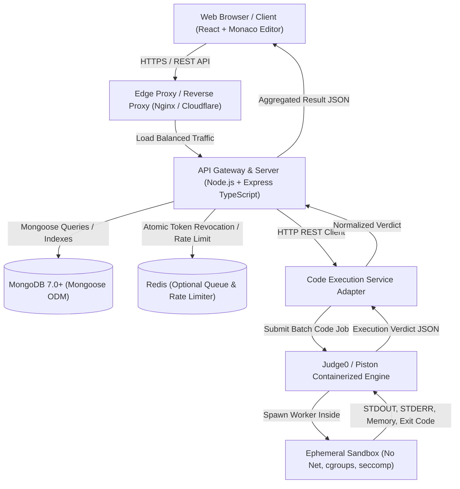
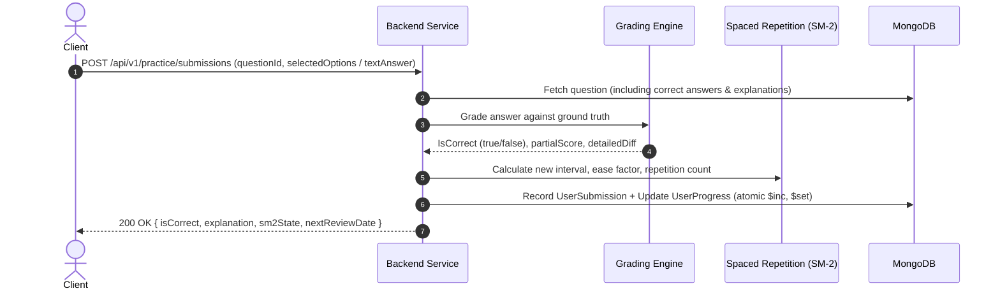
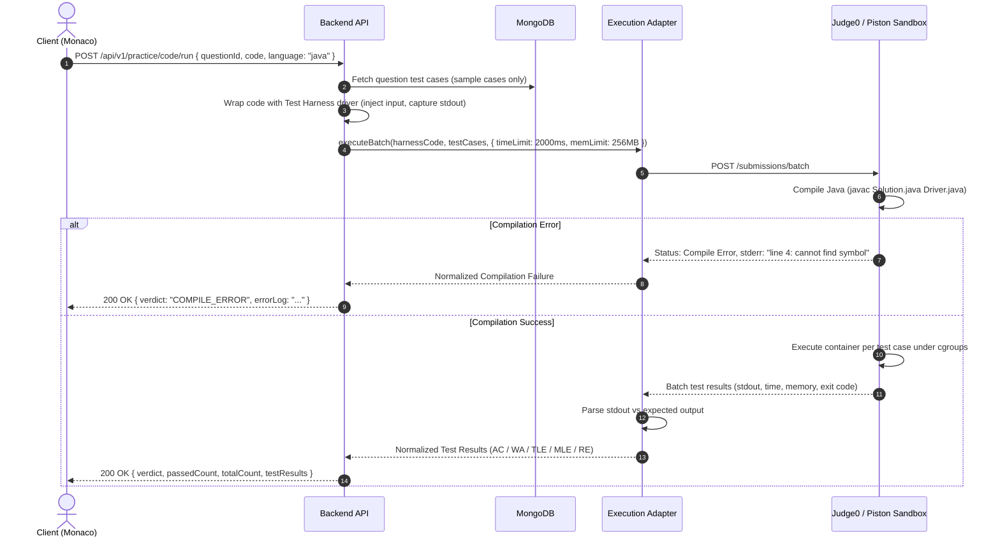

# CodeDrill — System Architecture & Technical Design

**Version:** 1.0.0  
**Status:** Approved for Review (Phase 0)  
**Author:** Full-Stack TypeScript Architect  

---

## 1. System Overview & Architectural Topology

CodeDrill is architected as a distributed, decoupled multi-service system comprising:
1. **`codedrill-frontend`:** High-performance Single Page Application (SPA) built with React 19 / Vite, Zustand, TanStack Query, Tailwind CSS, shadcn/ui, and the Monaco Editor.
2. **`codedrill-backend`:** Stateless, layered Node.js/Express REST API in strict TypeScript, handling authentication, business logic, validation, content serving, progress calculations, and sandbox dispatching.
3. **Database Tier:** MongoDB 7.0+ Replica Set (local or Atlas) for document storage, indexed queries, and atomic state updates.
4. **Code Execution Sandbox Tier:** Fully isolated sandbox engine utilizing a containerized execution runner (Judge0 CE or Piston) behind a unified backend adapter abstraction, protected by kernel-level isolation (`cgroups`, `seccomp`, `chroot`, unshared network namespaces).



---

## 2. Component Deconstruction

### 2.1 Frontend Architecture (`codedrill-frontend`)
- **Routing & Navigation:** React Router v7 with route-based code splitting (`React.lazy`) and nested route layouts (`RootLayout`, `AuthLayout`, `PracticeLayout`, `LearnLayout`, `AdminLayout`).
- **State Partitioning:**
  - **Server State:** Handled exclusively via **TanStack Query (v5)**. Implements aggressive caching, stale-while-revalidate, optimistic updates for bookmarks/notes, and automatic retry policies.
  - **Client & Session State:** Handled via **Zustand**. Slices manage:
    - `authSlice`: In-memory access token, current user snapshot, authentication status.
    - `editorSlice`: Monaco configuration, current active file/language, scratchpad code buffer, theme (vs-dark / light).
    - `practiceSessionSlice`: Active quiz index, chosen options, timer state, submission results.
    - `themeSlice`: Dark/light mode switching with CSS variable injection.
- **UI & Component Layer:** Tailwind CSS combined with accessible **shadcn/ui** primitives (Radix UI wrappers).
- **Code Editor Subsystem:** Monaco Editor wrapper with Java syntax highlighting, autocomplete for standard Java packages, customizable font sizing, and test case tab switching.

### 2.2 Backend Layered Architecture (`codedrill-backend`)
The backend strictly adheres to an inverted, layered domain architecture ensuring zero circular dependencies:

```
HTTP Request
     │
     ▼
┌────────────────────────────────────────────────────────┐
│  Middleware Layer                                      │
│  - Helmet (Security headers)                           │
│  - Pino Logger (Request context & correlation ID)      │
│  - CORS (Strict origin verification)                   │
│  - Rate Limiter (Token bucket per IP & User)           │
│  - Auth Middleware (JWT signature & revocation check)   │
└────────────────────────┬───────────────────────────────┘
                         │
                         ▼
┌────────────────────────────────────────────────────────┐
│  Router Layer (`/routes/*.routes.ts`)                  │
│  - URL mapping and verb binding                        │
│  - Route-level middleware composition                  │
└────────────────────────┬───────────────────────────────┘
                         │
                         ▼
┌────────────────────────────────────────────────────────┐
│  Validation Layer (`validateRequest(zodSchema)`)       │
│  - Validates `req.body`, `req.query`, and `req.params` │
│  - Fails fast with standardized 422/400 errors         │
└────────────────────────┬───────────────────────────────┘
                         │
                         ▼
┌────────────────────────────────────────────────────────┐
│  Controller Layer (`/controllers/*.controller.ts`)     │
│  - Extracts validated typed inputs                     │
│  - Maps HTTP responses and status codes                │
│  - Delegates all domain logic to Services              │
└────────────────────────┬───────────────────────────────┘
                         │
                         ▼
┌────────────────────────────────────────────────────────┐
│  Service Layer (`/services/*.service.ts`)              │
│  - Pure business logic (SM-2 calculations, grading)    │
│  - Transaction coordination (MongoDB sessions)         │
│  - Calls Repositories and External Adapters            │
└───────────┬────────────────────────────────┬───────────┘
            │                                │
            ▼                                ▼
┌───────────────────────────┐  ┌─────────────────────────┐
│ Repository / Data Layer   │  │ Execution Adapter Layer │
│ (`/models/*.model.ts`)    │  │ (`/adapters/*.ts`)       │
│ - Mongoose Schemas        │  │ - Judge0 / Piston HTTP   │
│ - Compound Indexes        │  │ - Payload normalizer     │
│ - Aggregation pipelines   │  │ - Timeout watchdog       │
└───────────────────────────┘  └─────────────────────────┘
```

---

## 3. End-to-End Data Flows

### 3.1 Authentication & Token Refresh Flow
Security requirements dictate that access tokens are short-lived (15 minutes) and stored **only in memory** on the client, while refresh tokens (7 days) are issued as `HttpOnly`, `SameSite=Strict`, `Secure` cookies with database-backed token family tracking for instant revocation.

```mermaid
sequenceDiagram
    autonumber
    actor User as Client (Browser)
    participant API as Backend Express API
    participant DB as MongoDB
    
    User->>API: POST /api/v1/auth/login (email, password)
    API->>DB: Find user by email + select passwordHash
    DB-->>API: User record (argon2/bcrypt hash)
    API->>API: Verify password & generate AccessToken (15m) + RefreshToken (7d)
    API->>DB: Insert RefreshToken record (hashed, linked to user session)
    API-->>User: Set-Cookie: refreshToken=...; HttpOnly; Secure; SameSite=Strict<br/>Response JSON: { accessToken, user }
    
    Note over User, API: Normal authenticated requests with Authorization: Bearer <AccessToken>
    
    User->>API: GET /api/v1/practice/questions (expired accessToken)
    API-->>User: 401 Unauthorized (TOKEN_EXPIRED)
    
    User->>API: POST /api/v1/auth/refresh (Cookie: refreshToken=...)
    API->>DB: Find active RefreshToken by hash
    alt Token valid and not revoked
        API->>DB: Invalidate current token, issue new token pair (Token Rotation)
        API-->>User: New Set-Cookie (new refresh token)<br/>Response JSON: { accessToken }
        User->>API: Retry original request with new AccessToken
    else Token revoked or reused (Replay Attack Detected)
        API->>DB: Invalidate ALL refresh tokens for this user family (Compromise defense)
        API-->>User: 403 Forbidden (SESSION_TERMINATED)
    end
```

### 3.2 Practice Submission & Instant Grading Flow (MCQ / Output / Fill-in)
For non-coding questions, grading happens deterministically inside the API service tier within < 50ms without invoking the sandbox runner:



### 3.3 Sandboxed Code Execution Flow (Coding Questions)
Coding questions run against visible test cases during "Run Code", and both visible + hidden test cases during "Submit Solution".



---

## 4. Key Architectural Decision Records (ADRs)

### ADR-01: Polyrepo vs. Monorepo Structure
- **Context:** Project requires two separate applications: `codedrill-frontend` and `codedrill-backend`.
- **Decision:** Distinct top-level folders `codedrill-frontend` and `codedrill-backend` with independent `package.json`, TypeScript configs, linting, and Dockerfiles, unified at root level with an overarching `/docs` directory and optional root `docker-compose.yml`.
- **Rationale:** Strict decoupling prevents backend dependencies or secrets from leaking into client bundles, simplifies independent CI/CD deployments (e.g., Vercel for frontend, Render/Railway/Fly.io/AWS for backend), and honors the exact constraint.

### ADR-02: Type Sharing via Generated OpenAPI Client (`openapi-typescript` + `openapi-fetch`)
- **Context:** Frontend must stay strictly type-synchronized with the backend REST API without manual duplication.
- **Decision:** The backend serves as the single source of truth for the OpenAPI 3.1 specification (`docs/openapi.yaml`). We utilize `openapi-typescript` to generate strict TypeScript type definitions for the frontend, combined with a type-safe fetch client (`openapi-fetch`) or custom TanStack Query wrappers.
- **Alternatives Considered:**
  - *Shared npm package:* Requires complex monorepo tooling (Turborepo/Nx, local link/publish steps), slowing down rapid development.
  - *tRPC:* Violates the strict REST API constraint and limits interoperability.
  - *Manual typing:* High risk of drift between backend payloads and frontend expectations.
- **Consequence:** Whenever a route or schema changes, running `npm run generate:api` in the frontend instantly brings updated typings and catches breaking changes at compile time.

### ADR-03: Code Execution Engine — Unified Adapter over Judge0 / Piston
- **Context:** Sandboxing untrusted user code (especially in Java) is prone to security vulnerabilities (arbitrary execution, fork bombs, network exfiltration, filesystem attacks). User code must never run in the API process.
- **Decision:** Implement an `ExecutionAdapter` interface in `codedrill-backend/src/adapters/execution/`:
  - `Judge0Adapter` (primary for production & local Docker runner).
  - `PistonAdapter` (alternative fallback).
  - `MockExecutionAdapter` (for fast unit testing without spinning up Docker).
- **Security Invariants:**
  - Disallow all socket/network creation (`--network none`).
  - Strict resource constraints: 2.0s wall clock, 256MB RAM, 100 process PID limit.
  - Read-only root filesystem with ephemeral `/tmp` volume mounted with `noexec` where possible.
  - Code execution runs as a non-root unprivileged user (`nobody` / `sandbox`).

### ADR-04: State Management: TanStack Query + Zustand
- **Context:** Complex UI needs both server data caching (questions, submissions, profiles) and local client state (Monaco editor buffer, test case inputs, active modal states).
- **Decision:** Avoid bloated single-store solutions (Redux boilerplate). Use **TanStack Query** for all server asynchronous state and **Zustand** for lightweight, granular client-only stores.
- **Trade-off:** Clean separation of concerns; zero boilerplate reducers; native optimistic UI capabilities.

### ADR-05: Database Schema: MongoDB with Mongoose
- **Context:** Rich question types require polymorphic data structures (e.g., MCQ options vs. Coding problem method templates and test suites).
- **Decision:** MongoDB document model using Mongoose with discriminators or tagged union schemas for the 5 question types, paired with compound indexes on `{ track, topicId, difficulty, type }` for sub-millisecond filtering.

---

## 5. Deployment Topology & Infrastructure

```mermaid
graph LR
    subgraph Edge
        DNS["DNS / Cloudflare"]
        WAF["Web Application Firewall & SSL"]
    end
    
    subgraph Frontend Hosting
        FE["Vercel / Cloudflare Pages / Static Nginx"]
    end
    
    subgraph Backend Cloud VPC
        LB["Application Load Balancer"]
        API1["Express API Instance 1"]
        API2["Express API Instance 2"]
    end
    
    subgraph Sandbox Cluster (Private VPC, No Public IP)
        Judge0["Judge0 Server & DB"]
        Worker["Isolated Worker (Docker-in-Docker / Podman)"]
    end
    
    subgraph Managed Data Stores
        MongoCluster[("MongoDB Atlas M10+ (Replica Set)")]
        RedisInstance[("Upstash / Managed Redis")]
    end
    
    DNS --> WAF
    WAF --> FE
    WAF --> LB
    LB --> API1
    LB --> API2
    API1 --> MongoCluster
    API2 --> MongoCluster
    API1 --> RedisInstance
    API2 --> RedisInstance
    API1 --> Judge0
    API2 --> Judge0
    Judge0 --> Worker
```

- **Environment Separation:** Strict staging and production environments configured via environment variables.
- **Health Checks & Telemetry:** Backend exposes `/health/liveness` and `/health/readiness` endpoints verifying database connectivity and execution sandbox availability.
- **Log Aggregation:** Structured JSON output via `pino` with correlation IDs (`x-request-id`) forwarded to Datadog or Grafana Loki.
