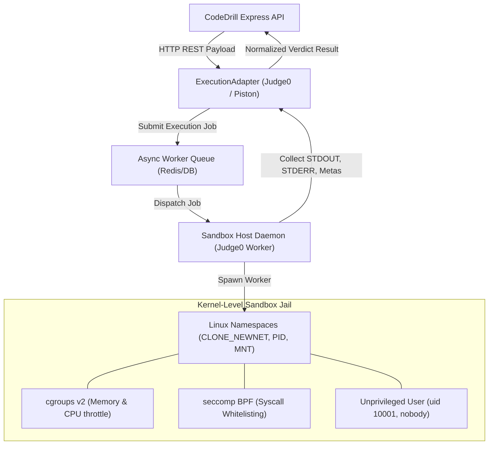

# CodeDrill — Sandboxed Code Execution Engine Specification

**Version:** 1.0.0  
**Status:** Approved for Review (Phase 0)  
**Author:** Full-Stack TypeScript Architect  

---

## 1. Sandbox Architecture & Isolation Strategy

CodeDrill executes untrusted user-submitted Java (and optional Python/JavaScript) code. Executing user-submitted code inside the primary Express API process is strictly prohibited. The system enforces multi-tier security and process isolation:



### 1.1 Linux Isolation Controls
1. **Network Virtualization (`CLONE_NEWNET`):** The sandbox network namespace is completely unmapped (`--network none`). User code cannot establish outbound TCP/UDP sockets, ping LAN IPs, or exfiltrate environment credentials.
2. **Resource Constraints (`cgroups v2`):**
   - **CPU Time Limit:** 2.0 seconds wall-clock time; 1.5 seconds CPU time.
   - **Memory Max:** 256 MB hard cap (enforced by `memory.max`). Exceeding this triggers an immediate `OOM-killer` resulting in `MEMORY_LIMIT_EXCEEDED`.
   - **PIDs Limit:** Maximum 100 concurrent threads/subprocesses (`pids.max = 100`), preventing fork bomb denial-of-service.
3. **Filesystem Confinement (`chroot` / OverlayFS):**
   - The root filesystem is mounted **Read-Only**.
   - `/tmp` is mounted as an in-memory `tmpfs` capped at 16MB with `noexec` flags where feasible.
4. **Syscall Filtering (`seccomp-bpf`):**
   - Blocks dangerous Linux kernel syscalls: `ptrace`, `sys_chroot`, `reboot`, `mount`, `keyctl`, and arbitrary packet socket creation.

---

## 2. Java Test Harness & Execution Lifecycle

For Java challenges, the user provides only the solution class/method (e.g., `class Solution { public int[] solve(...) }`). The backend wraps the submission in a tamper-proof driver harness before sending it to the sandbox runner.

### 2.1 Code Injection & Driver Compilation
```
+-----------------------------------------------------------+
| Generated File: SolutionDriver.java                       |
+-----------------------------------------------------------+
| 1. Standard Imports (java.util.*, java.io.*, java.math.*) |
| 2. USER SUBMISSION INJECTED HERE (class Solution)         |
| 3. Internal Driver (public class SolutionDriver)          |
|    - Reads JSON/standard input stream                     |
|    - Invokes Solution methods                             |
|    - Emits delimited test output tokens:                  |
|      ###TEST_CASE_START###                                |
|      {"caseId": 1, "output": ..., "timeMs": 14}           |
|      ###TEST_CASE_END###                                  |
+-----------------------------------------------------------+
```

### 2.2 Pre-Flight Static Analysis Check (Static Shield)
Before dispatching code to the sandbox, the backend executes a fast AST / regex verification check in `execution.service.ts` to reject blatant malicious patterns:
- Forbidden keywords: `java.lang.reflect`, `Runtime.getRuntime()`, `ProcessBuilder`, `System.exit()`, `SecurityManager`.
- Forbidden packages: `java.net.*`, `javax.net.*`, `java.rmi.*`.

---

## 3. Language & Runtime Matrix

| Language | Version | Compiler / Runtime Flag | Default Memory Cap | Wall-Clock Time Limit |
| :--- | :--- | :--- | :--- | :--- |
| **Java (Primary)** | OpenJDK 21 | `javac -encoding UTF-8` / `java -Xms32m -Xmx256m` | 256 MB | 2.5 seconds |
| **Python (Optional)** | 3.12 | `python3 -B -u` (disable bytecode caching) | 128 MB | 2.0 seconds |
| **JavaScript (Optional)** | Node 20 LTS | `node --max-old-space-size=128` | 128 MB | 2.0 seconds |

---

## 4. Test Case Schema & Verdict Statuses

### 4.1 Test Case Structure
```typescript
interface ITestCase {
  id: string;
  input: string;                  // e.g. "nums = [2, 7, 11, 15], target = 9"
  expectedOutput: string;         // e.g. "[0, 1]"
  isHidden: boolean;              // true for submission test cases
  weight: number;                 // Points awarded for passing
  timeLimitMs?: number;           // Overrides question-level time limit if set
}
```

### 4.2 Normalized Verdict Matrix

| Verdict Code | Description | Cause |
| :--- | :--- | :--- |
| `ACCEPTED` | All test cases passed with exact output matching. | Successful execution. |
| `WRONG_ANSWER` | Execution finished within limits, but output differed from expected. | Logical flaw in solution. |
| `TIME_LIMIT_EXCEEDED`| Execution exceeded time quota (e.g. infinite loop, O(N^2) on large inputs). | Timeout watchdog triggered. |
| `MEMORY_LIMIT_EXCEEDED`| Process consumed more than 256MB RAM. | Excessive allocation, heap overflow. |
| `COMPILE_ERROR` | `javac` exited with non-zero code. Error log captured from `stderr`. | Syntax error or invalid imports. |
| `RUNTIME_ERROR` | Unhandled exception thrown during execution (e.g. `NullPointerException`, `IndexOutOfBoundsException`). | Runtime crash. |
| `SANDBOX_FAILURE` | Container crashed, timed out on host, or failed to start. | Infrastructure issue; does not penalize user. |

---

## 5. Execution Adapter Pattern (`IExecutionAdapter`)

The backend abstracts sandbox interactions behind an interface to allow seamless switching between **Judge0**, **Piston**, and a local in-memory **MockAdapter** for unit tests.

```typescript
export interface ExecutionJobRequest {
  language: 'java' | 'javascript' | 'python';
  sourceCode: string;
  testCases: Array<{ input: string; expectedOutput: string }>;
  timeLimitMs: number;
  memoryLimitMb: number;
}

export interface TestCaseResult {
  passed: boolean;
  input: string;
  expectedOutput: string;
  actualOutput: string;
  executionTimeMs: number;
  memoryKb: number;
  error?: string;
}

export interface ExecutionJobResponse {
  verdict: 'ACCEPTED' | 'WRONG_ANSWER' | 'TIME_LIMIT_EXCEEDED' | 'MEMORY_LIMIT_EXCEEDED' | 'COMPILE_ERROR' | 'RUNTIME_ERROR';
  totalPassed: number;
  totalCases: number;
  compileOutput?: string;
  testResults: TestCaseResult[];
}

export interface IExecutionAdapter {
  execute(job: ExecutionJobRequest): Promise<ExecutionJobResponse>;
  checkHealth(): Promise<boolean>;
}
```

---

## 6. Rate Limiting & Abuse Prevention Controls

1. **Per-User Submission Quota:**
   - Authenticated users are capped at **15 code runs per minute** and **5 submissions per minute** via Redis/Token-bucket rate limiters.
2. **Concurrent Job Throttling:**
   - A single user account can have only **1 active execution job** in flight at any given second. Subsequent concurrent requests yield `429 Too Many Concurrent Jobs`.
3. **Payload Truncation:**
   - Source code submitted is capped at `64 KB`.
   - Captured STDOUT/STDERR is truncated at `32 KB` to prevent log buffer exhaustion.
