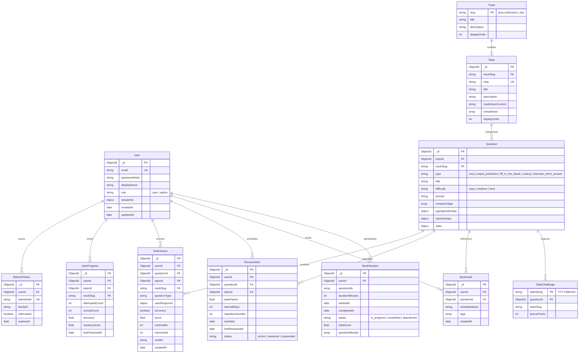

# CodeDrill — Data Model & Database Architecture

**Version:** 1.0.0  
**Status:** Approved for Review (Phase 0)  
**Database:** MongoDB 7.0+ (Mongoose ODM)  
**Author:** Full-Stack TypeScript Architect  

---

## 1. Entity-Relationship Overview

CodeDrill uses MongoDB to store hierarchical learning curriculum content, polymorphic question definitions, user interaction trails, and spaced repetition states.



---

## 2. Collections & Field Specifications

### 2.1 Collection: `users`
Represents an authenticated user on the platform.

```typescript
interface IUser {
  _id: Types.ObjectId;
  email: string;                  // lowercase, trimmed
  passwordHash: string;           // Argon2id hash
  displayName: string;
  avatarUrl?: string;
  role: 'user' | 'admin';
  streak: {
    currentStreak: number;
    longestStreak: number;
    lastActiveDate: string;       // Format: 'YYYY-MM-DD' (UTC)
    activityHistory: Array<{
      date: string;               // 'YYYY-MM-DD'
      count: number;              // Submissions on this day
    }>;
  };
  preferences: {
    theme: 'dark' | 'light' | 'system';
    editorFontSize: number;
    keyBindings: 'standard' | 'vim';
    emailNotifications: boolean;
  };
  createdAt: Date;
  updatedAt: Date;
}
```
- **Indexes:**
  - `{ email: 1 }` (Unique)
  - `{ "streak.currentStreak": -1 }` (Sparse, for leaderboards)

---

### 2.2 Collection: `refresh_tokens`
Stores cryptographically hashed refresh tokens with family tracking to prevent replay attacks.

```typescript
interface IRefreshToken {
  _id: Types.ObjectId;
  userId: Types.ObjectId;         // ref: 'User'
  tokenHash: string;              // SHA-256 hash of token
  familyId: string;               // UUID grouping rotations
  isRevoked: boolean;
  expiresAt: Date;
  createdAt: Date;
}
```
- **Indexes:**
  - `{ tokenHash: 1 }` (Unique)
  - `{ userId: 1, familyId: 1 }`
  - `{ expiresAt: 1 }` (TTL index for automatic document expiration)

---

### 2.3 Collection: `tracks`
Static root taxonomies: `java-collections` and `dsa`.

```typescript
interface ITrack {
  slug: 'java-collections' | 'dsa'; // Natural key
  title: string;
  description: string;
  iconName: string;
  displayOrder: number;
  totalTopics: number;
  totalQuestions: number;
}
```
- **Indexes:**
  - `{ slug: 1 }` (Unique)

---

### 2.4 Collection: `topics`
Curricular nodes within a track containing study notes and metadata.

```typescript
interface ITopic {
  _id: Types.ObjectId;
  trackSlug: 'java-collections' | 'dsa';
  slug: string;                   // e.g., 'hashmap-internals'
  title: string;                  // e.g., 'HashMap Internals & Hashing Mechanics'
  description: string;
  displayOrder: number;
  markdownContent: string;        // Full study notes with markdown & diagrams
  cheatSheet: Array<{
    operation: string;            // e.g. 'get(key)', 'put(key, value)'
    averageTime: string;          // e.g. 'O(1)'
    worstTime: string;            // e.g. 'O(log n)' (treeified) / 'O(n)'
    spaceComplexity: string;      // e.g. 'O(n)'
    notes: string;
  }>;
  prerequisites: Types.ObjectId[];// Array of topic ObjectIds
  estimatedReadTimeMinutes: number;
  createdAt: Date;
  updatedAt: Date;
}
```
- **Indexes:**
  - `{ trackSlug: 1, slug: 1 }` (Unique)
  - `{ trackSlug: 1, displayOrder: 1 }`

---

### 2.5 Collection: `questions` (Polymorphic Design)
Supports the 5 core question types. Shared metadata sits at root; type-specific data sits inside `typeSpecificData` and `solutionData`.

```typescript
type QuestionType = 
  | 'mcq'
  | 'output_prediction'
  | 'fill_in_the_blank'
  | 'coding'
  | 'interview_short_answer';

type Difficulty = 'easy' | 'medium' | 'hard';

interface IQuestion {
  _id: Types.ObjectId;
  trackSlug: 'java-collections' | 'dsa';
  topicId: Types.ObjectId;       // ref: 'Topic'
  type: QuestionType;
  title: string;
  difficulty: Difficulty;
  prompt: string;                 // Problem statement in markdown
  companyTags: string[];          // e.g. ['Amazon', 'Google', 'Morgan Stanley']
  hints: string[];

  // Polymorphic Question Payloads
  typeSpecificData: 
    | IMcqData
    | IOutputPredictionData
    | IFillInTheBlankData
    | ICodingData
    | IInterviewShortAnswerData;

  // Ground Truth Solution (hidden from client during normal practice)
  solutionData: 
    | IMcqSolution
    | IOutputPredictionSolution
    | IFillInTheBlankSolution
    | ICodingSolution
    | IInterviewShortAnswerSolution;

  stats: {
    totalAttempts: number;
    totalPassed: number;
    acceptanceRate: number;       // computed: (totalPassed / totalAttempts) * 100
  };
  isActive: boolean;
  createdAt: Date;
  updatedAt: Date;
}
```

#### Detailed Question Type Sub-schemas:
1. **MCQ (`mcq`):**
   ```typescript
   interface IMcqData {
     isMultiSelect: boolean;
     options: Array<{
       id: string;                // e.g., 'opt-a', 'opt-b'
       text: string;
       codeSnippet?: string;
     }>;
   }
   interface IMcqSolution {
     correctOptionIds: string[];  // e.g., ['opt-b']
     explanation: string;
     optionExplanations: Record<string, string>; // Explains why opt-a is wrong, opt-b is right
   }
   ```
2. **Output Prediction (`output_prediction`):**
   ```typescript
   interface IOutputPredictionData {
     codeSnippet: string;         // Java code snippet to analyze
     isMultipleChoice: boolean;   // If true, options provided; if false, user enters exact output
     options?: Array<{ id: string; text: string }>;
   }
   interface IOutputPredictionSolution {
     expectedOutput: string;      // Normalized string (trimmed whitespace)
     correctOptionId?: string;
     explanation: string;         // Step-by-step trace of JVM execution
   }
   ```
3. **Fill-in-the-Blank (`fill_in_the_blank`):**
   ```typescript
   interface IFillInTheBlankData {
     codeWithBlanks: string;      // Code with placeholders: `List<String> list = new {{blank_1}}<>()`
     blanks: Array<{
       id: string;                // e.g., 'blank_1'
       placeholderHint: string;   // e.g., 'Class implementation name'
     }>;
   }
   interface IFillInTheBlankSolution {
     acceptedAnswers: Record<string, string[]>; // e.g. { blank_1: ['ArrayList', 'LinkedList'] }
     explanation: string;
   }
   ```
4. **Coding Challenge (`coding`):**
   ```typescript
   interface ICodingData {
     starterCode: {
       java: string;
       javascript?: string;
       python?: string;
     };
     driverCode: {
       java: string;              // Hidden test runner wrapping user class
     };
     sampleTestCases: Array<{
       input: string;
       expectedOutput: string;
       explanation?: string;
     }>;
     constraints: string[];       // e.g. ["1 <= n <= 10^5", "Keys are non-null"]
     timeLimitMs: number;         // default 2000ms
     memoryLimitMb: number;       // default 256MB
   }
   interface ICodingSolution {
     referenceSolution: {
       java: string;
     };
     hiddenTestCases: Array<{
       input: string;
       expectedOutput: string;
       weight?: number;
     }>;
     complexityAnalysis: {
       time: string;
       space: string;
       notes: string;
     };
   }
   ```
5. **Interview Short-Answer (`interview_short_answer`):**
   ```typescript
   interface IInterviewShortAnswerData {
     suggestedTimeMinutes: number;
     keyConceptsToCover: string[];
   }
   interface IInterviewShortAnswerSolution {
     modelAnswerMarkdown: string; // Bullet-pointed ideal architectural answer
     evaluationRubric: Array<{
       criterion: string;         // e.g. "Mentions TREEIFY_THRESHOLD = 8"
       points: number;
     }>;
   }
   ```

- **Question Indexes:**
  - `{ trackSlug: 1, topicId: 1, difficulty: 1, type: 1 }` (Primary search index)
  - `{ companyTags: 1 }`
  - `{ isActive: 1, createdAt: -1 }`

---

### 2.6 Collection: `submissions`
Immutable audit log of every question attempt.

```typescript
interface ISubmission {
  _id: Types.ObjectId;
  userId: Types.ObjectId;
  questionId: Types.ObjectId;
  topicId: Types.ObjectId;
  trackSlug: 'java-collections' | 'dsa';
  questionType: QuestionType;
  userResponse: any;             // Exact submitted object/string/code
  isCorrect: boolean;
  score: number;                 // 0.0 to 1.0 (or partial for multi-test suites)
  verdict: 'ACCEPTED' | 'WRONG_ANSWER' | 'TIME_LIMIT_EXCEEDED' | 'MEMORY_LIMIT_EXCEEDED' | 'COMPILE_ERROR' | 'RUNTIME_ERROR' | 'SELF_EVALUATED';
  runtimeMs?: number;
  memoryKb?: number;
  testCaseSummary?: {
    passed: number;
    total: number;
  };
  feedback?: string;             // Optional compiler output or diff
  createdAt: Date;
}
```
- **Indexes:**
  - `{ userId: 1, createdAt: -1 }`
  - `{ userId: 1, questionId: 1, isCorrect: 1 }`
  - `{ questionId: 1, isCorrect: 1 }`

---

### 2.7 Collection: `user_progress`
Maintains aggregate performance per topic to eliminate costly on-the-fly map-reduce queries.

```typescript
interface IUserProgress {
  _id: Types.ObjectId;
  userId: Types.ObjectId;
  topicId: Types.ObjectId;
  trackSlug: 'java-collections' | 'dsa';
  attemptedQuestions: number;
  solvedQuestions: number;
  accuracyRate: number;          // (solved / attempted) * 100
  masteryScore: number;          // 0 to 100 (weighted score incorporating SM-2 retention & difficulty)
  isWeakTopic: boolean;          // true if attempted >= 5 and accuracyRate < 60%
  lastPracticedAt: Date;
  updatedAt: Date;
}
```
- **Indexes:**
  - `{ userId: 1, topicId: 1 }` (Unique compound key)
  - `{ userId: 1, isWeakTopic: 1 }`
  - `{ userId: 1, trackSlug: 1 }`

---

### 2.8 Collection: `revision_items`
Tracks spaced repetition intervals using an adapted SuperMemo-2 (SM-2) algorithm.

```typescript
interface IRevisionItem {
  _id: Types.ObjectId;
  userId: Types.ObjectId;
  questionId: Types.ObjectId;
  topicId: Types.ObjectId;
  trackSlug: 'java-collections' | 'dsa';
  easeFactor: number;            // Default 2.5, min 1.3
  intervalDays: number;          // Current gap in days
  repetitionNumber: number;      // Consecutive successful recalls
  dueDate: Date;                 // Date item is scheduled for review
  lastReviewedAt: Date;
  lastQualityScore: number;      // 0 to 5 SM-2 rating
  status: 'active' | 'mastered' | 'suspended';
  createdAt: Date;
  updatedAt: Date;
}
```
- **Indexes:**
  - `{ userId: 1, questionId: 1 }` (Unique)
  - `{ userId: 1, dueDate: 1, status: 1 }` (Active queue queries)

---

### 2.9 Collection: `bookmarks`
User notes and tagged saved problems.

```typescript
interface IBookmark {
  _id: Types.ObjectId;
  userId: Types.ObjectId;
  questionId: Types.ObjectId;
  noteMarkdown?: string;
  tags: string[];                // e.g. ['Tricky Contract', 'Interview Prep']
  createdAt: Date;
  updatedAt: Date;
}
```
- **Indexes:**
  - `{ userId: 1, questionId: 1 }` (Unique)
  - `{ userId: 1, createdAt: -1 }`

---

### 2.10 Collection: `daily_challenges`
Tracks the global featured problem for every calendar day.

```typescript
interface IDailyChallenge {
  dateString: string;            // 'YYYY-MM-DD' (Primary unique key)
  questionId: Types.ObjectId;
  trackSlug: 'java-collections' | 'dsa';
  bonusPoints: number;
  totalParticipants: number;
  totalCompletions: number;
  createdAt: Date;
}
```
- **Indexes:**
  - `{ dateString: 1 }` (Unique)

---

### 2.11 Collection: `mock_sessions`
Timed mock interview simulations.

```typescript
interface IMockSession {
  _id: Types.ObjectId;
  userId: Types.ObjectId;
  trackSlug?: 'java-collections' | 'dsa' | 'mixed';
  timeLimitMinutes: number;
  startedAt: Date;
  expiresAt: Date;
  completedAt?: Date;
  status: 'in_progress' | 'submitted' | 'expired';
  questions: Array<{
    questionId: Types.ObjectId;
    type: QuestionType;
    score: number;
    isCorrect: boolean;
    timeSpentSeconds: number;
  }>;
  totalScore: number;
}
```
- **Indexes:**
  - `{ userId: 1, startedAt: -1 }`

---

## 3. Example Documents

### 3.1 MCQ Question Example (Fail-Fast vs Fail-Safe)
```json
{
  "_id": "65e01234567890abcdef0001",
  "trackSlug": "java-collections",
  "topicId": "65e000000000000000000005",
  "type": "mcq",
  "title": "ArrayList Structural Modification via Iterator",
  "difficulty": "medium",
  "prompt": "Consider the following code snippet traversing an `ArrayList<String>`:\n\n```java\nList<String> list = new ArrayList<>(List.of(\"A\", \"B\", \"C\"));\nIterator<String> it = list.iterator();\nwhile (it.hasNext()) {\n    String val = it.next();\n    if (\"B\".equals(val)) {\n        it.remove();\n    }\n}\n```\nWhat occurs when this code executes?",
  "companyTags": ["Amazon", "Oracle"],
  "hints": ["Check whether `list.remove()` or `it.remove()` is called."],
  "typeSpecificData": {
    "isMultiSelect": false,
    "options": [
      { "id": "opt-1", "text": "Throws ConcurrentModificationException at runtime" },
      { "id": "opt-2", "text": "Executes successfully and removes \"B\" from the underlying list" },
      { "id": "opt-3", "text": "Causes an Infinite Loop because hasNext() is corrupted" },
      { "id": "opt-4", "text": "Compilation Error: remove() is unsupported on Iterator" }
    ]
  },
  "solutionData": {
    "correctOptionIds": ["opt-2"],
    "explanation": "Calling `Iterator.remove()` modifies both the underlying collection and updates the internal `expectedModCount` of the iterator to match `modCount`. Therefore, no `ConcurrentModificationException` is thrown. Had `list.remove(\"B\")` been called directly, `modCount` would diverge and throw `ConcurrentModificationException` on the subsequent `it.next()` call.",
    "optionExplanations": {
      "opt-1": "Incorrect. `ConcurrentModificationException` is only thrown if `list.remove()` is called while iterating without informing the iterator.",
      "opt-2": "Correct. `it.remove()` updates `expectedModCount = modCount`.",
      "opt-3": "Incorrect. Iteration advances monotonically without infinite looping.",
      "opt-4": "Incorrect. `Iterator.remove()` is a standard method in Java 1.2+."
    }
  },
  "stats": {
    "totalAttempts": 1420,
    "totalPassed": 890,
    "acceptanceRate": 62.68
  },
  "isActive": true
}
```

### 3.2 Output Prediction Example (ConcurrentHashMap Null Key)
```json
{
  "_id": "65e01234567890abcdef0002",
  "trackSlug": "java-collections",
  "topicId": "65e000000000000000000007",
  "type": "output_prediction",
  "title": "ConcurrentHashMap Null Key Handling",
  "difficulty": "easy",
  "prompt": "What is the exact output of running the following Java program?\n\n```java\nMap<String, Integer> map = new ConcurrentHashMap<>();\ntry {\n    map.put(null, 1);\n    System.out.println(\"Inserted: \" + map.get(null));\n} catch (NullPointerException e) {\n    System.out.println(\"NPE caught\");\n}\n```",
  "companyTags": ["Goldman Sachs", "Morgan Stanley"],
  "hints": ["Does ConcurrentHashMap permit null keys or values like HashMap does?"],
  "typeSpecificData": {
    "codeSnippet": "Map<String, Integer> map = new ConcurrentHashMap<>();\ntry {\n    map.put(null, 1);\n    System.out.println(\"Inserted: \" + map.get(null));\n} catch (NullPointerException e) {\n    System.out.println(\"NPE caught\");\n}",
    "isMultipleChoice": true,
    "options": [
      { "id": "opt-a", "text": "Inserted: 1" },
      { "id": "opt-b", "text": "Inserted: null" },
      { "id": "opt-c", "text": "NPE caught" },
      { "id": "opt-d", "text": "Compilation Error" }
    ]
  },
  "solutionData": {
    "expectedOutput": "NPE caught",
    "correctOptionId": "opt-c",
    "explanation": "Unlike standard `HashMap`, `ConcurrentHashMap` explicitly forbids both `null` keys and `null` values. Attempting to pass `null` to `put()`, `get()`, or `containsKey()` immediately throws a `NullPointerException`. Doug Lea designed this deliberately to prevent ambiguous states in multithreaded environments where `map.get(key) == null` cannot reliably distinguish between a missing key and a key mapped to `null`."
  },
  "stats": {
    "totalAttempts": 980,
    "totalPassed": 710,
    "acceptanceRate": 72.45
  },
  "isActive": true
}
```
