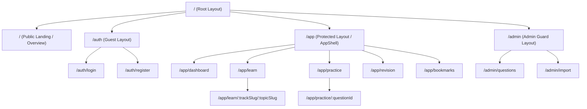

# CodeDrill — Frontend Architecture & UI/UX Specification

**Version:** 1.0.0  
**Stack:** React 19 / Vite / TypeScript (Strict) / Tailwind CSS / shadcn/ui / Monaco Editor / TanStack Query  
**Author:** Full-Stack TypeScript Architect  

---

## 1. Directory Structure

```
codedrill-frontend/
├── .env.example
├── .gitignore
├── index.html
├── package.json
├── tsconfig.json
├── vite.config.ts
├── src/
│   ├── assets/                     # Static icons, logos, brand illustrations
│   ├── components/                 # Reusable UI components
│   │   ├── ui/                     # shadcn/ui primitives (Button, Dialog, Tabs, etc.)
│   │   ├── layout/                 # AppShell, Navbar, Sidebar, Footer, Breadcrumbs
│   │   ├── feedback/               # Toast, LoadingSpinner, EmptyState, ErrorBoundary
│   │   ├── editor/                 # Monaco wrapper, LanguageSelector, KeybindModal
│   │   └── markdown/               # MarkdownRenderer with syntax highlighting
│   ├── features/                   # Domain-driven feature modules
│   │   ├── auth/                   # LoginForm, RegisterForm, AuthGuard
│   │   ├── curriculum/             # TrackCard, TopicList, CheatSheetTable
│   │   ├── practice/               # Multi-modal question components
│   │   │   ├── McqCard.tsx         # Single and multi-select MCQ
│   │   │   ├── OutputCard.tsx      # Output prediction snippet & input
│   │   │   ├── FillBlankCard.tsx   # Code block with inline input slots
│   │   │   ├── CodingWorkspace.tsx # Split-pane Monaco + Test Runner
│   │   │   └── InterviewCard.tsx   # Prompt, timer, self-evaluation rubric
│   │   ├── progress/               # MasteryRadar, StreakHeatmap, WeakTopicBanner
│   │   ├── revision/               # SpacedRepetitionFlashcard, SM2RatingBar
│   │   ├── bookmarks/              # BookmarkList, NoteEditorModal
│   │   └── admin/                  # QuestionForm, BulkImportDropzone, TopicForm
│   ├── hooks/                      # Custom utility hooks
│   │   ├── useDebounce.ts
│   │   ├── useKeyboardShortcuts.ts
│   │   └── useMediaQuery.ts
│   ├── routes/                     # React Router configurations & page views
│   │   ├── AppRoutes.tsx
│   │   ├── pages/
│   │   │   ├── HomePage.tsx
│   │   │   ├── LoginPage.tsx
│   │   │   ├── RegisterPage.tsx
│   │   │   ├── LearnPage.tsx        # Topic browser
│   │   │   ├── TopicDetailPage.tsx  # Topic study notes + cheat sheets
│   │   │   ├── PracticePage.tsx     # Question list & filters
│   │   │   ├── SolvePage.tsx        # Question practice view
│   │   │   ├── RevisionPage.tsx     # SM-2 revision queue
│   │   │   ├── BookmarksPage.tsx
│   │   │   ├── DashboardPage.tsx    # Analytics & progress charts
│   │   │   └── admin/
│   │   │       ├── AdminDashboard.tsx
│   │   │       └── AdminImportPage.tsx
│   ├── services/                   # Typed API client & queries
│   │   ├── api.client.ts           # openapi-fetch configured instance
│   │   ├── queries/                # TanStack query hooks (useTopics, useQuestions)
│   │   └── mutations/              # TanStack mutation hooks (useSubmitAnswer)
│   ├── stores/                     # Zustand client state stores
│   │   ├── authStore.ts            # User session, token in memory
│   │   ├── editorStore.ts          # Monaco buffer, active tab, user drafts
│   │   └── themeStore.ts           # Dark/light mode
│   ├── types/                      # Auto-generated & local UI types
│   │   ├── api.d.ts                # Auto-generated from openapi.yaml
│   │   └── practice.types.ts
│   ├── utils/                      # Helper utilities
│   │   ├── cn.ts                   # clsx + tailwind-merge helper
│   │   └── formatters.ts           # Date, score, big-O formatting
│   ├── index.css                   # Tailwind v4 directives and CSS custom properties
│   └── main.tsx                    # Root entry point with React Query & Auth provider
```

---

## 2. Navigation & Route Hierarchy



---

## 3. State Partitioning Strategy

| State Category | Tool | Scope & Contents | Persistence Mechanism |
| :--- | :--- | :--- | :--- |
| **Server Cache** | TanStack Query v5 | Questions list, topic guides, submissions, user stats, bookmarks. | In-memory with `staleTime: 5 mins` + garbage collection. |
| **Auth Session** | Zustand (`authStore`) | Current access token (JWT), user object, authenticated boolean. | Token in memory; automatic refresh token handshake on reload. |
| **Monaco Buffer** | Zustand (`editorStore`) | Unsaved code drafts per question, active font size, editor theme. | `localStorage` fallback (debounced 1s) to prevent code loss. |
| **UI Theme** | Zustand (`themeStore`) | `dark` vs `light` mode. | `localStorage` with `prefers-color-scheme` fallback. |

---

## 4. UI/UX Wireframes

### 4.1 Split-Pane Coding & Problem Workspace (`/practice/:questionId`)
```
+----------------------------------------------------------------------------------------------------+
| [Logo] CodeDrill   [Track: Java Collections] > [Topic: HashMap Internals]     [Streak: 🔥 5] [User] |
+----------------------------------------------------------------------------------------------------+
|  LEFT PANE (Tabs: Problem | Hints | Notes)      | RIGHT PANE (Editor & Test Console)               |
|                                                | [Language: Java 21 v] [Theme v] [Reset] [Shortcuts]|
|  # 14. Custom HashMap with Collision Chaining   |--------------------------------------------------|
|  Difficulty: [Medium]  Tags: [Amazon] [Hash]    | 1  import java.util.*;                           |
|                                                | 2                                                 |
|  ## Problem Statement                          | 3  class MyHashMap<K, V> {                        |
|  Implement a simplified generic HashMap with   | 4      private static final int CAPACITY = 16;   |
|  separate chaining collision resolution...     | 5      private Node<K, V>[] buckets;             |
|                                                | 6                                                 |
|  ### Constraints:                              | 7      public void put(K key, V val) {           |
|  - 0 <= key.hashCode() <= 10^9                 | 8          // TODO: implement put                 |
|  - Key can be null (handle bucket index 0)     | 9      }                                         |
|                                                | 10 }                                              |
|                                                |--------------------------------------------------|
|  ### Example 1:                                | TEST CONSOLE [Console v]                          |
|  Input: put("apple", 1), get("apple")          | [Case 1: Passed] [Case 2: Passed] [Case 3: Failed] |
|  Output: 1                                     | Input: put("apple", 1), get("banana")             |
|                                                | Expected: null                                    |
|                                                | Output: 1                                         |
|------------------------------------------------+--------------------------------------------------|
| [Bookmark ⭐]   [Need Help?]                   | [Run Code (Ctrl+Enter)]   [Submit Solution (Cmd+S)]|
+----------------------------------------------------------------------------------------------------+
```

### 4.2 Spaced Repetition Active Recall Flashcard (`/app/revision`)
```
+----------------------------------------------------------------------------------------------------+
| REVISION QUEUE (Cards Due Today: 4 / 12)                                        [Back to Dashboard]|
+----------------------------------------------------------------------------------------------------+
|                                                                                                    |
|    +------------------------------------------------------------------------------------------+    |
|    | TOPIC: Concurrent Collections (Fail-Fast vs Fail-Safe)                  Difficulty: Hard |    |
|    |                                                                                          |    |
|    | PROMPT:                                                                                  |    |
|    | Under what exact conditions will `ConcurrentHashMap.keySet().iterator()` throw a         |    |
|    | `ConcurrentModificationException`?                                                       |    |
|    |                                                                                          |    |
|    | [ Show Answer / Reveal Model Solution (Spacebar) ]                                       |    |
|    +------------------------------------------------------------------------------------------+    |
|                                                                                                    |
|    [REVEALED STATE BELOW:]                                                                         |
|    +------------------------------------------------------------------------------------------+    |
|    | MODEL ANSWER:                                                                            |    |
|    | Never! ConcurrentHashMap iterators are 'weakly consistent' (fail-safe). They operate     |    |
|    | on a snapshot/iterator view that reflects state at creation and can tolerate concurrent   |    |
|    | modifications without throwing ConcurrentModificationException.                          |    |
|    +------------------------------------------------------------------------------------------+    |
|                                                                                                    |
|    RATE YOUR RECALL QUALITY (SM-2):                                                                |
|    [ 0 - Blackout ]  [ 1 - Incorrect ]  [ 2 - Hard ]  [ 3 - Good ]  [ 4 - Easy ]  [ 5 - Perfect ]  |
|                                                                                                    |
+----------------------------------------------------------------------------------------------------+
```

---

## 5. Accessibility (a11y) & Design Systems Rules

1. **Keyboard Accessibility:**
   - Global shortcuts: `Cmd/Ctrl + Enter` to run code; `Cmd/Ctrl + S` to submit; `Cmd + K` for global search command palette.
   - All interactive elements possess explicit ARIA labels and visible focus rings (`focus-visible:ring-2 focus-visible:ring-primary`).
2. **Color Palette & Dark Mode Invariants:**
   - Built on modern Tailwind CSS variables supporting seamless theme switching:
     - `background`: Dark `hsl(222, 47%, 11%)`, Light `hsl(0, 0%, 100%)`.
     - `primary`: Vibrant Indigo/Violet `hsl(246, 80%, 60%)`.
     - `accent-success`: Mint Green `hsl(152, 69%, 45%)`.
     - `accent-error`: Crimson `hsl(354, 70%, 54%)`.
     - `accent-warning`: Amber `hsl(38, 92%, 50%)`.
   - Contrast ratio exceeds **WCAG AA standards (>= 4.5:1)** for all text and interactive UI elements.
3. **Responsive Breakpoints:**
   - `sm` (640px): Stacked mobile layout; Monaco editor switches to simplified single-column view with bottom drawer for test results.
   - `md` (768px): Tablet layout; collapsible sidebar navigation.
   - `lg` (1024px+): Full split-pane desktop workspace with resizable splitters.
